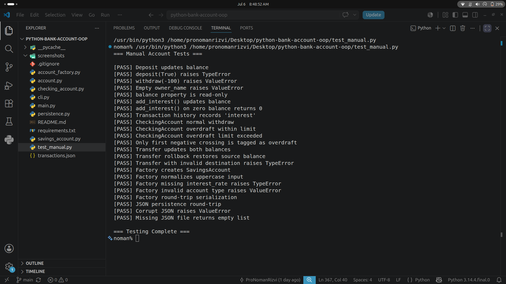
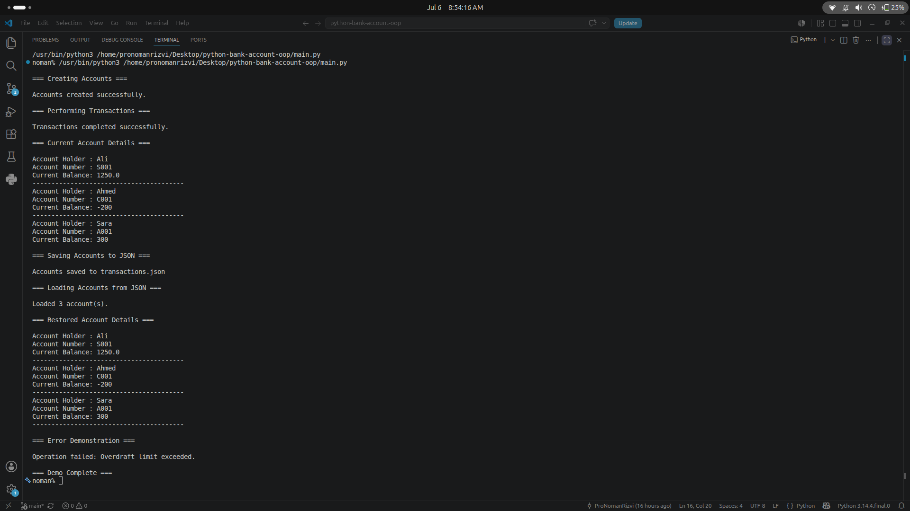
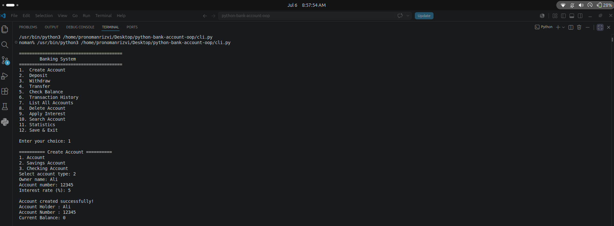
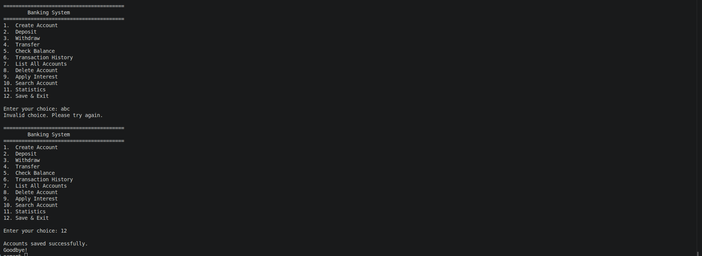
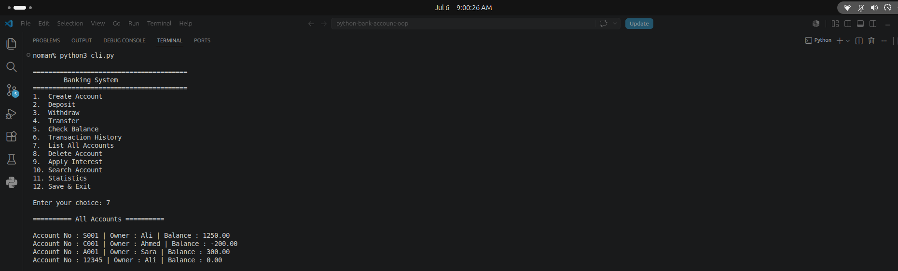

# Bank Account System — OOP Capstone Project

A command-line banking system built from scratch in Python to demonstrate core Object-Oriented Programming principles: inheritance, encapsulation, polymorphism, and design patterns (Factory), along with JSON-based data persistence.

## Features

- **Multiple account types** — base `Account`, `SavingsAccount` (interest-bearing), `CheckingAccount` (overdraft-enabled)
- **Core banking operations** — deposit, withdraw, transfer between accounts, balance inquiry
- **Transaction history** — every operation is logged with type, amount, timestamp, and resulting balance
- **Factory Pattern** — centralized, type-safe account creation via `AccountFactory`
- **JSON persistence** — accounts and their full state survive across sessions
- **Interactive CLI** — a menu-driven banking interface for real-time account management
- **37 automated tests** — covering normal operations, invalid values, transfer rollback, and persistence failures

## Project Structure

```
python-bank-account-oop/
├── account.py              # Base Account class (encapsulation, validation, transfer logic)
├── savings_account.py      # SavingsAccount (interest calculation)
├── checking_account.py     # CheckingAccount (overdraft handling)
├── account_factory.py      # AccountFactory (Factory Pattern + serialization dispatch)
├── persistence.py          # JSON save/load functions
├── main.py                 # Automated demo of all features
├── cli.py                  # Interactive banking CLI
├── test_manual.py          # Original 23 assert-based tests
├── tests/                 # Pytest regression tests
├── .github/workflows/     # CI for supported Python versions
├── requirements-dev.txt   # Test dependency
├── transactions.json       # Persisted account data (generated at runtime)
├── screenshots/            # Terminal/test run screenshots
└── requirements.txt
```

## Design Decisions & OOP Concepts

**Encapsulation**
Balance is stored as `_balance` and exposed only through a read-only `@property`. This prevents any code from directly setting a balance without going through `deposit()`/`withdraw()`, which enforce validation and maintain an audit trail (`transaction_history`).

**Inheritance & Polymorphism**
`SavingsAccount` and `CheckingAccount` inherit from `Account` and override behavior where needed. `CheckingAccount.withdraw()` overrides the base method entirely to support overdrafts, while `SavingsAccount` reuses `deposit()` internally for `add_interest()`. The CLI and `transfer()` method call `account.withdraw()` polymorphically — neither needs to know the concrete subclass at runtime.

**Factory Pattern**
`AccountFactory.create_account()` centralizes object creation based on a type string, keeping instantiation logic out of client code. `AccountFactory.create_from_dict()` reuses this same method during deserialization, so there is a single source of truth for how each account type is built.

**Transfer Atomicity**
`transfer()` snapshots both accounts' balances and transaction histories. If either withdrawal or deposit raises an exception, it restores both in-memory states and re-raises the error. Failed transfers leave no transaction entries. This does not roll back external side effects in custom subclasses or provide database-level atomicity.

**Validation & Persistence**
Balances, deposits, withdrawals, interest rates, and overdraft limits reject NaN and infinity. Saving writes a complete JSON document to a temporary file before replacing the old file, so a failed serialization does not truncate existing data. Loading rejects non-finite JSON numbers.

**Serialization Design**
Each class implements `to_dict()` using `super().to_dict()` to avoid duplicating common fields, then layers on its own type-specific data (`interest_rate`, `overdraft_limit`). State restoration during loading is handled by a `_restore_state()` method inside `Account` itself — keeping direct manipulation of private attributes inside the class instead of external persistence code.

## Screenshots

**Test Suite — All 23 Tests Passing**


**Automated Demo (`main.py`) — Full Feature Walkthrough**


**Interactive CLI — Creating an Account**


**Interactive CLI — Invalid Input Handling & Save**


**Interactive CLI — Persistence Verified After Restart**


## Requirements

- Python 3.10+ (developed and tested on Ubuntu, Python 3.14)
- No runtime dependencies — uses the Python standard library
- `pytest` is a development/test dependency (see `requirements-dev.txt`)

## Usage

### Automated Demo
Runs through account creation, transactions, save/load, and an error-handling example automatically:

```bash
python3 main.py
```

### Interactive CLI
A menu-driven banking system for creating accounts and performing operations manually:

```bash
python3 cli.py
```

Accounts are automatically loaded from `transactions.json` on startup and saved back on exit (option: **Save & Exit**).

### Running Tests

```bash
python3 -m pip install -r requirements-dev.txt
python3 -m pytest -q
```

The 37-test suite includes the original 23 tests plus regression tests for non-finite values, balance overflow, partial transfer failure, JSON failure, and valid overdrafts. CI runs the suite on Python 3.11 and 3.12. The original standalone runner remains available with `python3 test_manual.py`; it now exits nonzero if a test fails.

The original 23 tests print `[PASS]`/`[FAIL]` results, covering:
- Validation (types, negative amounts, empty fields, boolean rejection)
- Encapsulation (read-only balance property)
- Inheritance behavior (interest calculation, overdraft limits)
- Transfer rollback on failure
- Factory creation and error handling
- Full JSON save/load round-trips, including corrupted-file recovery

## Scope

This is an OOP learning project, not a production banking ledger. It uses Python floats and local JSON; real financial systems need fixed-precision money, durable transactional storage, concurrency control, and audit controls.

## Author

**Noman Rizvi**
BS Software Engineering, University of Agriculture, Faisalabad
GitHub: [ProNomanRizvi](https://github.com/ProNomanRizvi) · Kaggle/Hugging Face: [ProNomanRizvi](https://huggingface.co/ProNomanRizvi)
